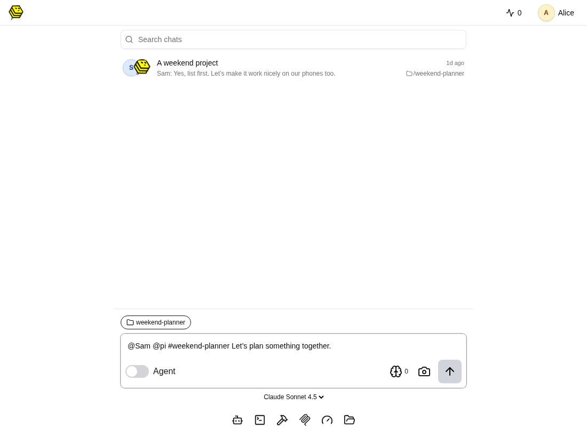
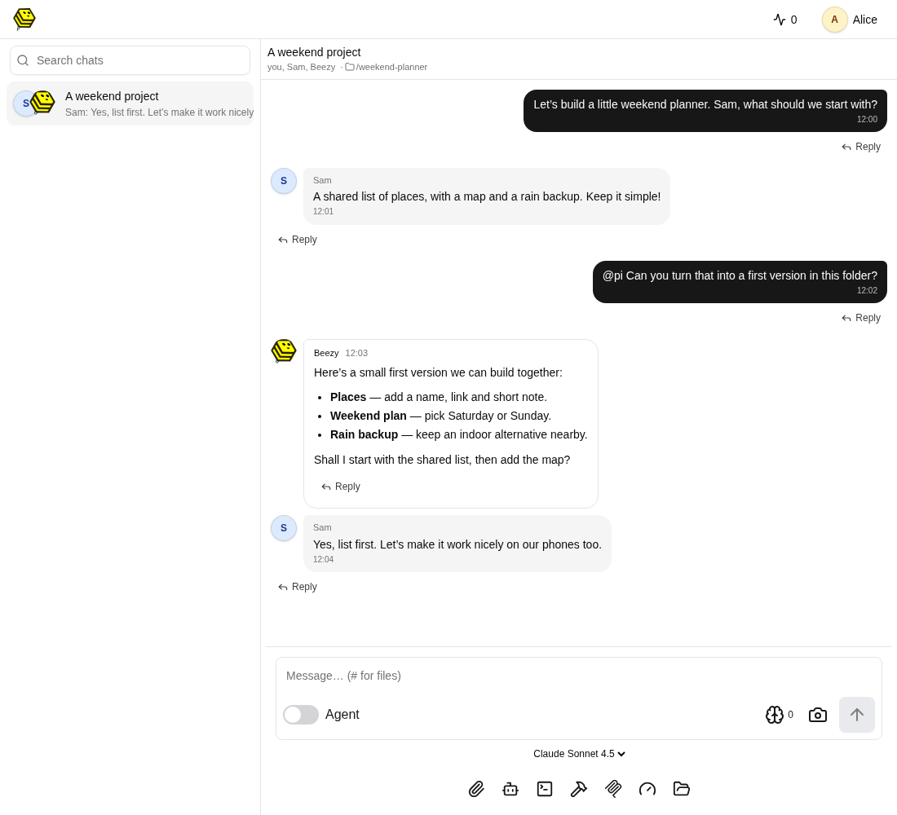
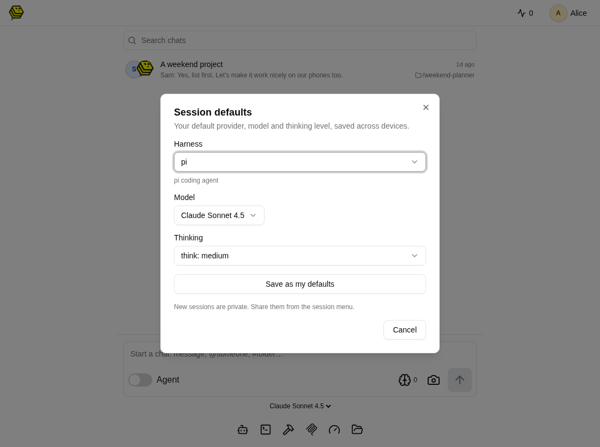
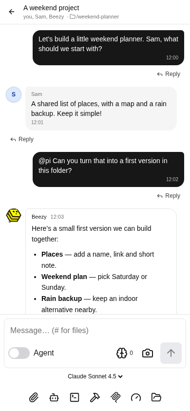

<p align="center">
  
</p>

# Beezy

**A shared chat app for people and their coding agent.**

Run Beezy on your computer or Raspberry Pi, then use it from a browser or phone. Chat with each other, bring in the [pi coding agent](https://github.com/earendil-works/pi) with `@pi`, and work on files together. Agents keep working when you close the browser.

- Human-only chats, private agent chats, or both in the same conversation.
- Choose a working folder, browse files, and preview the agent’s output.
- A [shared browser](docs/browser.md) per session: see your app live together and pick elements to ask about.
- Pick your model, reply to messages, and steer or stop an agent.
- Separate accounts for your group; an installable mobile web app.

## Install

You need **Node.js 22.19+**, npm and Git on Linux or macOS. A model-provider login or API key is needed to use the agent; provider charges are separate.

One command installs **Beezy `beezy-v0.1.0` + pi `0.85.1`**, using Beezy’s dependency lockfiles:

```bash
curl -fsSL https://raw.githubusercontent.com/PAndreew/pi_group/beezy-v0.1.0/deploy/install.sh | bash
```

Prefer to inspect scripts first? [Read the installer](deploy/install.sh), download it, then run it with Bash. It needs no sudo, keeps pi private to this installation, and refuses to overwrite an existing install.

Then log in to your model provider and start Beezy:

```bash
cd ~/.local/share/beezy
.runtime/node_modules/.bin/pi  # type /login, then /quit when finished
npm start
```

Open **http://localhost:8787** and sign in as **admin** with the password printed by the installer (also saved in `.env`). Stop with Ctrl+C; run `npm start` again whenever you need it.

The installer binds to localhost. To connect from your phone on the same network, set `HOST=0.0.0.0` in `.env`, restart, and open `http://<computer-address>:8787`. Use HTTPS for remote access and notifications, and set `COOKIE_SECURE=true` when serving over HTTPS.

<details>
<summary>Install manually / run from source</summary>

```bash
npm install -g @earendil-works/pi-coding-agent@0.85.1
pi  # /login, then /quit

git clone --branch beezy-v0.1.0 https://github.com/PAndreew/pi_group.git
cd pi_group
cp .env.example .env  # choose FS_ROOT and a strong ADMIN_PASSWORD
npm run setup
npm run build
npm start
```

If you omit `ADMIN_PASSWORD`, the first start prints a generated password. If you already use pi, Beezy can use that installation and its provider login.

</details>

## Start a chat

Use the message box on the home screen:

- **With the agent:** `@pi Help me build a small website.`
- **With a person:** `@Sam What should we work on?`
- **Together:** `@Sam @pi #weekend-planner Let’s plan something together.`

`#folder` picks where the agent works; without it, Beezy uses the shared chat folder. In a group chat, mention `@pi` when you want the agent to respond. Add accounts from your user menu → **Manage users**.



## People + agent, one conversation

Alice and Sam discuss a weekend planner, then ask Beezy to help.



## Choose your defaults

Open your user menu → **Session defaults**, choose a model and thinking level, then **Save as my defaults**. The controls below the message box let you change a session’s settings too.



## On your phone

Use the same chats in your mobile browser. Add Beezy to your home screen for an app-like experience.



*Screenshots show the real UI with fictional Alice/Sam accounts and scripted agent replies—not a live model run. [Regenerate the demo screenshots](web/test/readme-screenshots.mjs).*

## A few settings worth knowing

Edit `.env` and restart Beezy. See [`.env.example`](.env.example) for all options.

| Setting | What it controls |
|---|---|
| `FS_ROOT` | Files everyone can browse; the installer creates a dedicated `workspace` folder. |
| `CHAT_FOLDER` | Working folder for chats without a `#folder`. |
| `HOST` / `PORT` | Listen address and port. |
| `ADMIN_PASSWORD` | Initial admin password; change existing passwords in the app. |
| `PI_BIN` | Which pi executable to use. |

### Agent runtimes

Each person picks their runtime, provider, model and reasoning level under user menu → **Settings**; new sessions and chats start with them, and a session's model and reasoning can still be switched under its message box.

- **pi** (default): pi over RPC, with Beezy's agent tools (secret vault, scheduled jobs, questions, file links, shared browser).
- **pi durable**: runs inside the server and survives restarts.

**Only invite people you trust with shell access to this machine.** Anyone who can prompt the agent can ask it to run commands with the server user’s permissions. `FS_ROOT` limits the file browser, not the agent.

Service setup, updates and development commands: [Operations](docs/operations.md). How it fits together, and how a deployment swaps the storage and runtime underneath: [Architecture](docs/architecture.md).

## Tenants

Use the home toolbar's **Tenant** selector to keep Work and Family conversations, default agent folders and memory separate. Access checks run on the server; OS-level agent isolation is still a separate deployment step. See [tenant setup and boundaries](docs/tenants.md).

## Secrets

Keep API tokens and passwords in the **Secret vault** (user menu). Agents see each secret's key and description, and read a value only when a task needs it. The vault runs as a separate service (`npm run start:vault`). See [secret vault](docs/vault.md).

## Optional Cloudflare assistance

User menu → **Cloudflare assistance** offers independent, off-by-default switches for Clef prompt-injection checks, Clairic tool-result extraction, and Clairic tool discovery. These cost money and send relevant content to Cloudflare. One account-scoped Workers AI token serves both models. Currently supports the Pi RPC harness only. See [configuration, limits and comparison guidance](docs/cloudflare-assistance.md).

## License

[GNU AGPL-3.0](LICENSE). You may use, change and self-host Beezy freely; if you offer a modified version to others over a network, you must publish your changes under the same license.
